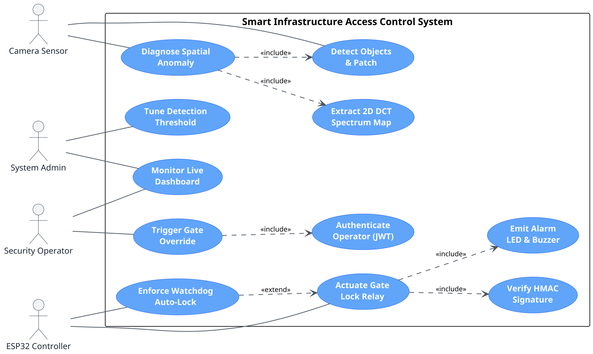
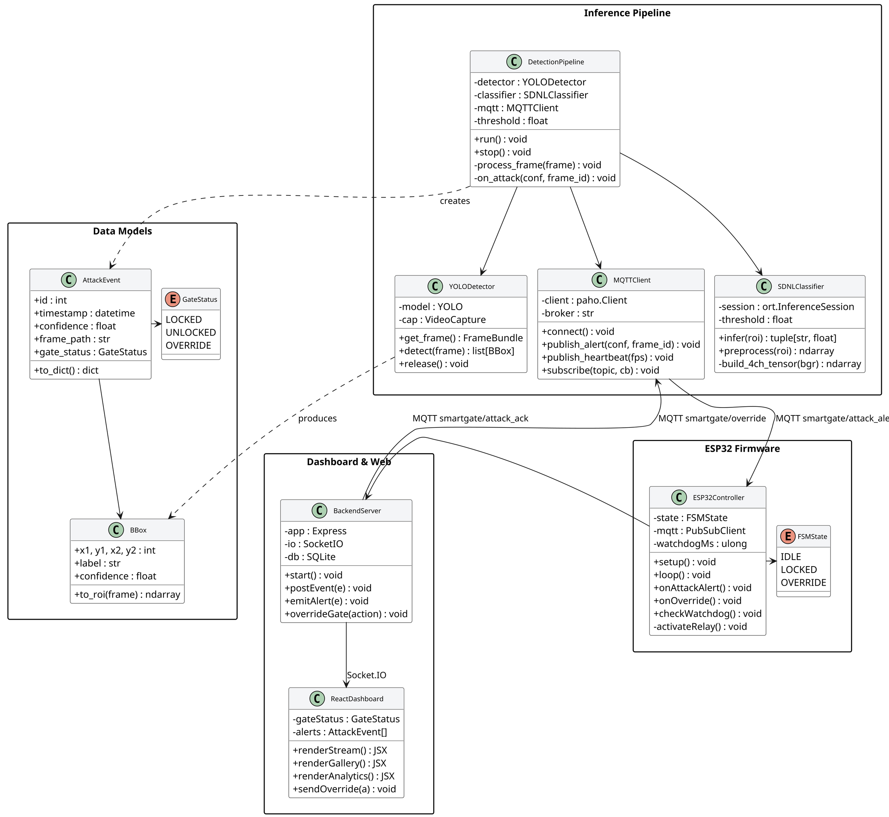
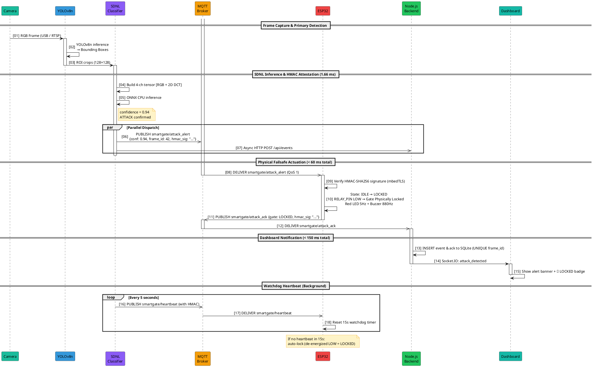

# DIAGRAM SOURCE CODE & PROMPTS

This document contains all standalone diagram definitions, UML source code, and visual prompts for the Capstone Project.

---

## Section 9: Architecture Eraser.io Prompt

```
title Smart Access Control Defense System Architecture

Camera [icon: camera, color: teal] {
  label: "Camera\n(USB / IP)\nRGB @ 30 FPS"
}

PC [icon: monitor, color: blue] {
  label: "Edge Inference Host\n(PC / Laptop)"

  YOLOv8n [icon: cpu, color: indigo] {
    label: "YOLOv8n\nObject Detector"
  }

  SDNL [icon: chip, color: purple] {
    label: "SDNL CNN\n4-ch ONNX CPU\n<500K params · 1.66ms"
  }

  MQTT_PUB [icon: radio, color: cyan] {
    label: "MQTT Publisher\n+ Frame Store"
  }

  Backend [icon: server, color: green] {
    label: "Node.js Backend\n+ Mosquitto Broker\n+ SQLite DB"
  }

  Dashboard [icon: layout-dashboard, color: emerald] {
    label: "React Dashboard\nLive Stream · Alerts\nAnalytics · Override"
  }
}

ESP32 [icon: microchip, color: orange] {
  label: "ESP32\nFailsafe Controller"

  Relay [icon: toggle-right, color: red] {
    label: "Relay → Gate Lock\nRelay Output"
  }

  Indicators [icon: bell, color: amber] {
    label: "Red LED · Buzzer\nGreen LED · Button"
  }
}

GateLock [icon: lock, color: red] {
  label: "Gate Lock\n12V Relay-controlled"
}

// Connections
Camera --> YOLOv8n: "RGB Frames"
YOLOv8n --> SDNL: "ROI Crops"
SDNL --> MQTT_PUB: "ATTACK ≥ 0.70"
MQTT_PUB --> Backend: "HTTP POST /api/events"
Backend --> Dashboard: "Socket.IO events"
MQTT_PUB --> ESP32: "MQTT smartgate/attack_alert (QoS 1)"
ESP32 --> Backend: "MQTT smartgate/attack_ack"
ESP32 <--> Backend: "heartbeat / status"
Dashboard --> Backend: "POST /api/gate (override)"
Relay --> GateLock: "Relay Output LOW → LOCK (Fail-Secure)"
```

---

## Section 10.1: Standard UML Use Case Diagram (PlantUML)



### **Use Case Diagram Narrative Description**

The Use Case Diagram defines the operational boundary interactions for the Smart Infrastructure Access Control System across four external actors and six core functional use cases. The Camera Sensor actor initiates visual threat evaluation by interacting with the primary object detection and spatial anomaly diagnosis use cases (`Detect Objects & Patch` and `Diagnose Spatial Anomaly`), which mandatorily include 2D Discrete Cosine Transform spectral extraction (`Extract 2D DCT Spectrum Map`) to construct 4-channel tensors. Upon confirming an adversarial patch anomaly exceeding the tuned confidence threshold (0.70), the ESP32 Controller actor interacts with the hardware actuation use case (`Actuate Gate Lock Relay`) to maintain a de-energized LOW relay state (fail-secure posture), mandatorily including Zero-Trust payload signature verification (`Verify HMAC Signature`) and local alarm signaling (`Emit Alarm LED & Buzzer`). Additionally, the watchdog auto-lock use case (`Enforce Watchdog Auto-Lock`) extends relay actuation if the 15-second host heartbeat is lost. Human actors interact through dedicated security interface use cases: the Security Operator interacts with live dashboard monitoring (`Monitor Live Dashboard`) and manual override controls (`Trigger Gate Override`), which mandatorily include operator JWT bearer token verification (`Authenticate Operator`), while the System Administrator interfaces with system tuning controls (`Tune Detection Threshold`) to modify detection sensitivity parameters at runtime.

---

## Section 10.2: Class Diagram (PlantUML)



---

## Section 10.3: Sequence Diagram (PlantUML)

