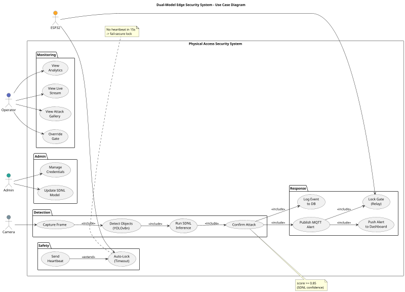
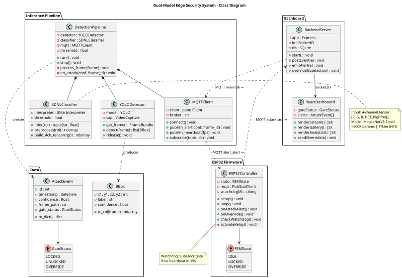
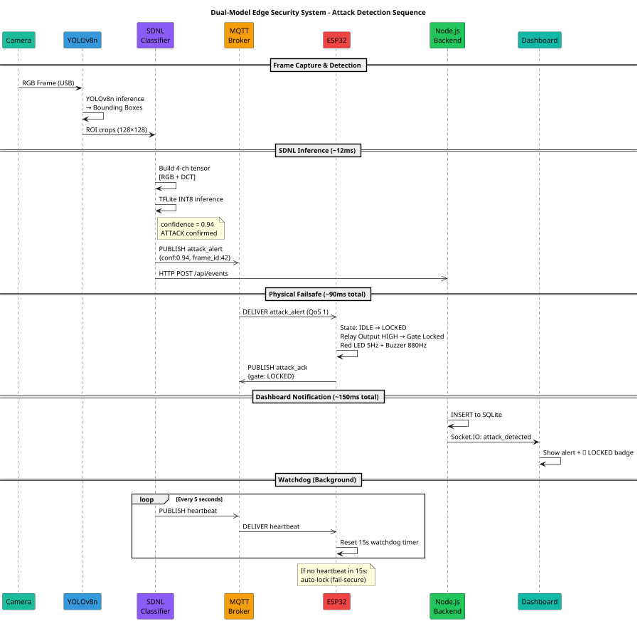

# DIAGRAM SOURCE CODE & PROMPTS

This document contains all standalone diagram definitions, UML source code, and visual prompts for the Capstone Project.

---

## Section 9: Architecture Eraser.io Prompt

```
title Smart Access Control Defense System Architecture

Camera [icon: camera, color: teal] {
  label: "Camera\n(USB / IP)\nRGB @ 30 FPS"
}

PC [icon: monitor, color: blue] {
  label: "Edge Inference Host\n(PC / Laptop)"

  YOLOv8n [icon: cpu, color: indigo] {
    label: "YOLOv8n\nObject Detector"
  }

  SDNL [icon: chip, color: purple] {
    label: "SDNL CNN\n4-ch TFLite INT8\n<500K params · ≤15ms"
  }

  MQTT_PUB [icon: radio, color: cyan] {
    label: "MQTT Publisher\n+ Frame Store"
  }

  Backend [icon: server, color: green] {
    label: "Node.js Backend\n+ Mosquitto Broker\n+ SQLite DB"
  }

  Dashboard [icon: layout-dashboard, color: emerald] {
    label: "React Dashboard\nLive Stream · Alerts\nAnalytics · Override"
  }
}

ESP32 [icon: microchip, color: orange] {
  label: "ESP32\nFailsafe Controller"

  Relay [icon: toggle-right, color: red] {
    label: "Relay → Gate Lock\nRelay Output"
  }

  Indicators [icon: bell, color: amber] {
    label: "Red LED · Buzzer\nGreen LED · Button"
  }
}

GateLock [icon: lock, color: red] {
  label: "Gate Lock\n12V Relay-controlled"
}

// Connections
Camera --> YOLOv8n: "RGB Frames"
YOLOv8n --> SDNL: "ROI Crops"
SDNL --> MQTT_PUB: "ATTACK ≥ 0.85"
MQTT_PUB --> Backend: "HTTP POST /api/events"
Backend --> Dashboard: "Socket.IO events"
MQTT_PUB --> ESP32: "MQTT attack_alert (QoS 1)"
ESP32 --> Backend: "MQTT attack_ack"
ESP32 <--> Backend: "heartbeat / status"
Dashboard --> Backend: "POST /api/gate (override)"
Relay --> GateLock: "Relay Output HIGH → LOCK"
```

---

## Section 10.1: Use Case Diagram (PlantUML)



---

## Section 10.2: Class Diagram (PlantUML)



---

## Section 10.3: Sequence Diagram (PlantUML)




# Use case
```@startuml
skinparam dpi 300
skinparam packageStyle rectangle
skinparam linetype ortho
skinparam nodesep 25
skinparam ranksep 25
skinparam usecase {
  BackgroundColor White
  BorderColor #333333
}

actor "Camera" as CAM #78909C
actor "ESP32" as ESP #FFA726
actor "Operator" as OP #5C6BC0
actor "Admin" as AD #26A69A

rectangle "System Boundaries" {

  ' --- PACKAGE 1: Detection (2x2 Grid Layout) ---
  package "Detection" {
    usecase "Capture Frame" as UC1
    usecase "Detect Objects\n(YOLOv8n)" as UC2
    usecase "Run SDNL\nInference" as UC3
    usecase "Confirm Attack" as UC4

    UC1 .> UC2 : <<include>>
    UC2 -down-> UC3
    UC3 .> UC4 : <<include>>
    UC2 -[hidden]right-> UC4
  }

  ' --- PACKAGE 2: Response ---
  package "Response" {
    usecase "Publish MQTT\nAlert" as UC5
    usecase "Lock Gate\n(Relay)" as UC6
    usecase "Log Event\nto DB" as UC7
    usecase "Push Alert\nto Dashboard" as UC8

    UC5 .> UC6 : <<include>>
    UC5 .> UC8 : <<include>>
  }

  ' --- PACKAGE 3: Safety ---
  package "Safety" {
    usecase "Send\nHeartbeat" as UC15
    usecase "Auto-Lock\n(Timeout)" as UC16

    UC15 .> UC16 : <<extend>>
  }

  ' --- PACKAGE 4: Monitoring ---
  package "Monitoring" {
    usecase "View Live Stream" as UC9
    usecase "View Attack Gallery" as UC10
    usecase "Override Gate" as UC11
    usecase "View Analytics" as UC12
  }

  ' --- PACKAGE 5: Admin ---
  package "Admin" {
    usecase "Update SDNL Model" as UC13
    usecase "Manage Credentials" as UC14
  }
}

' --- Strict Vertical Package Flow ---
"Detection" -[hidden]down-> "Response"
"Response" -[hidden]down-> "Safety"
"Safety" -[hidden]down-> "Monitoring"
"Monitoring" -[hidden]down-> "Admin"

' --- Cross-Package Relationships ---
UC4 .> UC5 : <<include>>
UC4 .> UC7 : <<include>>

' --- Actor Connections ---
CAM --> UC1
ESP --> UC6
ESP --> UC16

OP --> UC9
OP --> UC10
OP --> UC11
OP --> UC12

AD --> UC13
AD --> UC14

' --- Notes ---
note bottom of UC4
  score >= 0.85
  (SDNL confidence)
end note

note bottom of UC16
  No heartbeat in 15s
  -> fail-secure lock
end note

@enduml
```


# Sequence
```
@startuml
' Visual Polish & Theme Configuration
skinparam shadowing false
skinparam monochrome false
skinparam SequenceMessageAlignment center
skinparam defaultFontName "Segoe UI", "Helvetica", "Arial", sans-serif
skinparam defaultFontSize 12
skinparam NoteBackgroundColor #FEF3C7
skinparam NoteBorderColor #F59E0B
skinparam DividerBackgroundColor #F3F4F6
skinparam DividerBorderColor #E5E7EB

autonumber "[00]"

' Participants
participant "Camera" as CAM #1ABC9C
participant "YOLOv8n" as YOLO #3498DB
participant "SDNL\nClassifier" as SDNL #8b5cf6
participant "MQTT\nBroker" as MQTT #f59e0b
participant "ESP32" as ESP #ef4444
participant "Node.js\nBackend" as NODE #22c55e
participant "Dashboard" as UI #14b8a6

== Frame Capture & Detection ==
CAM -> YOLO : RGB Frame (USB)
activate YOLO
YOLO -> YOLO : YOLOv8n inference\n→ Bounding Boxes
YOLO -> SDNL : ROI crops (128×128)
deactivate YOLO
activate SDNL

== SDNL Inference (~12ms) ==
SDNL -> SDNL : Build 4-ch tensor [RGB + DCT]
SDNL -> SDNL : TFLite INT8 inference
note right of SDNL
confidence = 0.94
ATTACK confirmed
end note

par Parallel Dispatch
SDNL ->> MQTT : PUBLISH attack_alert\n{conf: 0.94, frame_id: 42}
SDNL ->> NODE : HTTP POST /api/events
end
deactivate SDNL

== Physical Failsafe (~90ms total) ==
activate MQTT
MQTT ->> ESP : DELIVER attack_alert (QoS 1)
deactivate MQTT
activate ESP

ESP -> ESP : State: IDLE → LOCKED\nRelay Output HIGH → Gate Locked\nRed LED 5Hz + Buzzer 880Hz
ESP ->> MQTT : PUBLISH attack_ack {gate: LOCKED}
deactivate ESP

activate MQTT
MQTT ->> NODE : DELIVER attack_ack {gate: LOCKED}
deactivate MQTT

== Dashboard Notification (~150ms total) ==
activate NODE
NODE -> NODE : INSERT event & ack to SQLite
NODE -> UI : Socket.IO: attack_detected
deactivate NODE
activate UI
UI -> UI : Show alert banner + LOCKED badge
deactivate UI

== Watchdog (Background) ==
loop Every 5 seconds
SDNL ->> MQTT : PUBLISH heartbeat
MQTT ->> ESP : DELIVER heartbeat
ESP -> ESP : Reset 15s watchdog timer
end

note over ESP
If no heartbeat in 15s:
auto-lock (fail-secure)
end note

@enduml
```

# Class Diagram
```
@startuml
skinparam dpi 300
skinparam packageStyle rectangle
skinparam classAttributeIconSize 0
skinparam nodesep 15
skinparam ranksep 20

' Class Styling
skinparam class {
  BackgroundColor White
  HeaderBackgroundColor #F4F5F7
  BorderColor #333333
  FontSize 10
}

' ==========================================
' TOP-LEFT: DATA MODELS
' ==========================================
package "Data Models" {
  class AttackEvent {
    + id : int
    + timestamp : datetime
    + confidence : float
    + frame_path : str
    + gate_status : GateStatus
    + to_dict() : dict
  }

  enum GateStatus {
    LOCKED
    UNLOCKED
    OVERRIDE
  }

  class BBox {
    + x1, y1, x2, y2 : int
    + label : str
    + confidence : float
    + to_roi(frame) : ndarray
  }

  AttackEvent -right-> GateStatus
  AttackEvent -down-> BBox
}


' ==========================================
' TOP-RIGHT: INFERENCE PIPELINE
' ==========================================
package "Inference Pipeline" {
  class DetectionPipeline {
    - detector : YOLODetector
    - classifier : SDNLClassifier
    - mqtt : MQTTClient
    - threshold : float
    + run() : void
    + stop() : void
    - process_frame(frame) : void
    - on_attack(conf, frame_id) : void
  }

  class YOLODetector {
    - model : YOLO
    - cap : VideoCapture
    + get_frame() : FrameBundle
    + detect(frame) : list[BBox]
    + release() : void
  }

  class MQTTClient {
    - client : paho.Client
    - broker : str
    + connect() : void
    + publish_alert(conf, frame_id) : void
    + publish_heartbeat(fps) : void
    + subscribe(topic, cb) : void
  }

  class SDNLClassifier {
    - interpreter : tflite.Interpreter
    - threshold : float
    + infer(roi) : tuple[str, float]
    + preprocess(roi) : ndarray
    - build_4ch_tensor(rgb) : ndarray
  }

  DetectionPipeline -down-> YOLODetector
  DetectionPipeline -down-> MQTTClient
  DetectionPipeline -down-> SDNLClassifier

  YOLODetector -[hidden]right-> MQTTClient
  MQTTClient -[hidden]right-> SDNLClassifier
}


' ==========================================
' BOTTOM-LEFT/MIDDLE: ESP32 FIRMWARE
' ==========================================
package "ESP32 Firmware" {
  class ESP32Controller {
    - state : FSMState
    - mqtt : PubSubClient
    - watchdogMs : ulong
    + setup() : void
    + loop() : void
    + onAttackAlert() : void
    + onOverride() : void
    + checkWatchdog() : void
    - activateRelay() : void
  }

  enum FSMState {
    IDLE
    LOCKED
    OVERRIDE
  }

  ESP32Controller -right-> FSMState
}


' ==========================================
' BOTTOM-RIGHT: DASHBOARD & WEB
' ==========================================
package "Dashboard & Web" {
  class BackendServer {
    - app : Express
    - io : SocketIO
    - db : SQLite
    + start() : void
    + postEvent(e) : void
    + emitAlert(e) : void
    + overrideGate(action) : void
  }

  class ReactDashboard {
    - gateStatus : GateStatus
    - alerts : AttackEvent[]
    + renderStream() : JSX
    + renderGallery() : JSX
    + renderAnalytics() : JSX
    + sendOverride(a) : void
  }

  BackendServer -down-> ReactDashboard : "Socket.IO"
}


' ==========================================
' RELATIVE LAYOUT CONSTRAINTS
' ==========================================
"Data Models" -[hidden]right-> "Inference Pipeline"

"Inference Pipeline" -[hidden]down-> "ESP32 Firmware"

' Forces Dashboard & Web to sit strictly to the right of ESP32 Firmware
"ESP32 Firmware" -right[hidden]-> "Dashboard & Web"


' ==========================================
' CROSS-PACKAGE RELATIONSHIPS
' ==========================================
DetectionPipeline ..> AttackEvent : "creates"
YOLODetector ..> BBox : "produces"

MQTTClient -down-> ESP32Controller : "MQTT alert"
ESP32Controller -right-> BackendServer : "MQTT ack"
BackendServer -up-> MQTTClient : "MQTT override"


@enduml
```